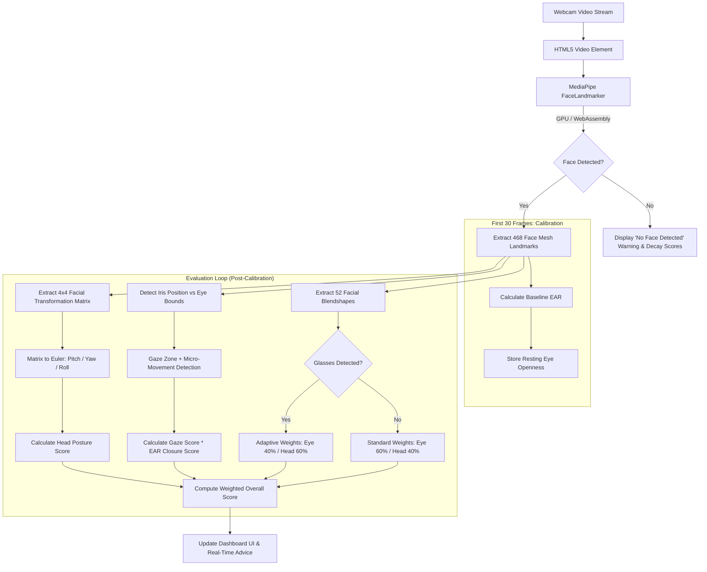

# Body Language Scoring for Interviews

<div align="center">


<p align="center">
  <strong>An intelligent, privacy-first web application that evaluates non-verbal interview presence in real time using edge computer vision and facial biomechanics.</strong>
</p>

[Key Features](#key-features) •
[Architecture & Pipeline](#architecture--pipeline) •
[Scoring Methodology](#scoring-methodology) •
[Quickstart](#getting-started) •
[System Structure](#project-structure) •
[Privacy Guarantee](#privacy--edge-computing-guarantee)

</div>

---

## Overview

Non-verbal communication accounts for a substantial portion of interpersonal impact during interviews and professional presentations. **Body Language Scoring for Interviews** provides an automated, objective feedback loop by analyzing live video directly within the browser. 

Powered by **Google MediaPipe FaceLandmarker**, the application extracts dense 3D facial landmarks, iris tracking coordinates, and head transformation matrices at high frame rates. It synthesizes these physical signals into real-time metrics—including **Gaze Stability**, **Eye Contact Quality**, **3D Head Orientation**, and **Overall Engagement**—without streaming or storing a single frame to any remote server.

---

## Key Features

- **100% Client-Side & Zero-Latency**: All model inference runs locally via WebAssembly and WebGL/GPU delegates. No backend servers, external APIs, or latency overhead.
- **Dense 3D Face Mesh & Iris Tracking**: Utilizes MediaPipe's refined 468+ point facial mesh alongside 8 dedicated iris landmarks (`LEFT_IRIS`, `RIGHT_IRIS`).
- **Full 3D Head Orientation (Euler Angles)**: Calculates continuous **Pitch**, **Yaw**, and **Roll** angles derived directly from the facial transformation matrix.
- **Quadrant-Based Gaze Zone Detection**: Dynamically partitions eye bounding boxes into horizontal and vertical quadrants to detect gaze shifts away from the interviewer/camera.
- **Micro-Saccade & Jitter Detection**: Analyzes frame-by-frame gaze volatility and applies dampening penalties for nervous eye movement.
- **Adaptive EAR (Eye Aspect Ratio) Calibration**: Calibrates against the user's resting facial baseline across the first 30 frames to normalize natural eye opening and blink rates.
- **Eyewear & Glasses Compensation**: Evaluates facial blendshapes (`eyeGlasses`, `darkGlasses`) to dynamically adapt score weighting if eyewear reflections or occlusions are present.
- **In-Situ Visual Feedback**: Displays non-intrusive on-screen guidance nudging candidates to align their posture or re-establish eye contact.

---

## Architecture & Pipeline



---

## Scoring Methodology

### 1. Head Pose Estimation (Euler Decomposition)
The 4x4 facial transformation matrix $M$ provided by MediaPipe is decomposed into 3D rotational Euler angles:

$$\text{Pitch} = \text{atan2}(M_{9}, M_{10}) \times \frac{180}{\pi}$$

$$\text{Yaw} = \text{atan2}\left(-M_{8}, \sqrt{M_{9}^2 + M_{10}^2}\right) \times \frac{180}{\pi}$$

$$\text{Roll} = \text{atan2}(M_{4}, M_{0}) \times \frac{180}{\pi}$$

Each angle is evaluated against a maximum acceptable threshold $\theta_{\max} = 25^\circ$ using a smooth logistic decay curve combined with an excess penalty:

$$\text{Base Score} = \frac{1}{3} \sum_{\alpha \in \{\text{Pitch}, \text{Yaw}, \text{Roll}\}} \frac{1}{1 + e^{k \cdot (|\alpha| - \theta_{\max})}}$$

$$\text{Score}_{\text{head}} = \max\left(0,\, \text{Base Score} - \sum_{\alpha} \max(0, |\alpha| - \theta_{\max}) \cdot \lambda\right)$$

*(where $k = 0.25$ steepness coefficient, $\lambda = 0.15$ angle penalty factor).*

---

### 2. Gaze Direction & Iris Zone Mapping
Each eye is bounded by horizontal landmarks (corners) and vertical landmarks (eyelids). The bounding rectangle is segmented into a $4 \times 4$ quadrant coordinate space:
- **Horizontal**: `Left` ($x < \frac{1}{4}W$), `Center` ($\frac{1}{4}W \le x \le \frac{3}{4}W$), `Right` ($x > \frac{3}{4}W$)
- **Vertical**: `Up` ($y < \frac{1}{4}H$), `Center` ($\frac{1}{4}H \le y \le \frac{3}{4}H$), `Down` ($y > \frac{3}{4}H$)

Deviations from center incur penalties:
- Off-center gaze receives a baseline multiplier penalty ($0.1\times$ horizontal/vertical).
- Multi-directional gaze deviations apply an additional compound penalty ($0.7\times$).

---

### 3. Eye Aspect Ratio (EAR) & Blink Normalization
To prevent false negatives during natural blinks while catching prolonged eye closure or looking down:

$$\text{EAR} = \frac{\|p_{\text{top}} - p_{\text{bottom}}\|}{2 \cdot \|p_{\text{left}} - p_{\text{right}}\| + \epsilon}$$

During the **first 30 frames**, the system calculates the participant's resting $\text{EAR}_{\text{baseline}}$:
- **$\text{EAR} \ge 0.5 \cdot \text{EAR}_{\text{baseline}}$**: Natural, open gaze ($1.0$ multiplier).
- **$0.3 \cdot \text{EAR}_{\text{baseline}} \le \text{EAR} < 0.5 \cdot \text{EAR}_{\text{baseline}}$**: Partial droop / squint ($0.3$ multiplier).
- **$\text{EAR} < 0.3 \cdot \text{EAR}_{\text{baseline}}$**: Closed eye / prolonged downward blink ($0.0$ multiplier).

---

### 4. Saccadic Jitter & Micro-Movement Penalty
Erratic eye shifts (nervous darting) are tracked across a sliding 5-frame temporal window. Every sudden transition across cardinal gaze quadrants adds a penalty factor:

$$\text{Penalty}_{\text{motion}} = \min(0.40, \, N_{\text{transitions}} \times 0.20)$$

$$\text{Score}_{\text{eye, final}} = \max\left(0,\, \text{Score}_{\text{gaze}} \cdot \text{Score}_{\text{EAR}} - \text{Penalty}_{\text{motion}}\right)$$

---

### 5. Adaptive Eyewear Compensation
When blendshapes detect eyeglasses or tinted lenses (`eyeGlasses` / `darkGlasses` score $> 0.5$):
- **Standard Condition**: $\text{Eye Weight} = 60\%$, $\text{Head Weight} = 40\%$
- **Eyewear Condition**: $\text{Eye Weight} = 40\%$, $\text{Head Weight} = 60\%$

This compensation prevents lens glare and frame occlusion from unfairly depressing the candidate's aggregate score.

---

## Project Structure

```text
Bodylanguage_scoring/
├── index.html        # Semantic HTML5 UI layout, Material design styling, viewport config
├── script.js          # Core inference loop, MediaPipe loader, mathematical scoring engines
├── styles.css         # Modern responsive CSS, video & canvas overlays, card layouts
└── README.md          # Comprehensive technical documentation & project guide
```

---

## Getting Started

### Prerequisites
- A modern web browser supporting **WebAssembly** and **WebGL2** (Google Chrome, Microsoft Edge, Brave, Firefox, or Safari).
- A functional webcam or external video capture device.

### Installation & Launch

1. **Clone the repository:**
   ```bash
   git clone https://github.com/AhryRaj/Bodylanguage_scoring.git
   cd Bodylanguage_scoring
   ```

2. **Serve with a local HTTP server:**
   
   > [!IMPORTANT]
   > Modern browsers require a secure context (`localhost` or `https://`) to grant webcam access via `navigator.mediaDevices.getUserMedia`.

   You can use any of the following standard lightweight servers:

   **Using Python 3:**
   ```bash
   python3 -m http.server 8000
   ```

   **Using Node.js (npx):**
   ```bash
   npx serve .
   ```

   **Using VS Code Live Server:**
   Right-click `index.html` and choose **"Open with Live Server"**.

3. **Access the Application:**
   Open your browser and navigate to:
   ```text
   http://localhost:8000
   ```

4. **Grant Camera Permissions:**
   Click **"ENABLE WEBCAM"** and allow camera access when prompted by the browser. Hold still for approximately 1-2 seconds during the initial 30-frame calibration period.

---

## Best Practices for Accurate Scoring

| Factor | Recommendation | Rationale |
| :--- | :--- | :--- |
| **Camera Position** | Eye level, centered | Prevents false head-pitch or downward gaze bias |
| **Lighting** | Even front-lighting, avoid backlight | Ensures accurate iris landmark coordinate resolution |
| **Distance** | 50 cm – 90 cm (arm's length) | Keeps face within optimal landmark resolution range |
| **Background** | Clean, non-distracting | Eliminates background contrast artifacts |
| **Calibration** | Look forward at the lens for 2 sec | Establishes a clean baseline EAR measurement |

---

## Privacy & Edge-Computing Guarantee

- **Zero Cloud Ingestion**: Video streams and landmark coordinates are processed strictly in your browser's local memory.
- **No Frame Recording**: No images, video clips, or audio streams are written to disk or recorded.
- **Ephemeral State**: All rolling counters and metrics reset cleanly whenever the webcam is toggled off or the page is refreshed.

---

## Tech Stack & Dependencies

- **Runtime & Language**: Vanilla JavaScript (ES6 Modules)
- **Computer Vision Framework**: [@mediapipe/tasks-vision](https://www.npmjs.com/package/@mediapipe/tasks-vision) (`0.10.3`)
- **Model Bundle**: `face_landmarker.task` (Float16 quantized, GPU accelerated)
- **UI & Layout**: HTML5, Vanilla CSS3 Flexbox/Grid, Material Design Components (MDC Web)
- **Typography**: Google Fonts (Poppins)

---

## Future Roadmap

- [ ] **Upper-Body Posture Analysis**: Integrate `MediaPipe PoseLandmarker` to evaluate slouching, shoulder symmetry, and open body postures.
- [ ] **Affect & Expression Scoring**: Surface micro-expression metrics (confidence, smile frequency, composure) using facial blendshape vectors.
- [ ] **Speech Cadence Integration**: Add Web Audio API integration for speech rate (WPM), pause duration, and filler word detection.
- [ ] **Session Performance Report**: Export downloadable PDF assessment summaries with historical trend charts.

---

## Contributing

Contributions, bug reports, and feature requests are welcome!

1. Fork the Project.
2. Create your Feature Branch (`git checkout -b feature/AmazingFeature`).
3. Commit your Changes (`git commit -m 'Add some AmazingFeature'`).
4. Push to the Branch (`git push origin feature/AmazingFeature`).
5. Open a Pull Request.

---

## Author & Contact

**Ahryraj Varatharaja**  
- **GitHub**: [@AhryRaj](https://github.com/AhryRaj)  
- **Email**: [varaahry2000@gmail.com](mailto:varaahry2000@gmail.com)  
- **Repository**: [Bodylanguage_scoring](https://github.com/AhryRaj/Bodylanguage_scoring)

---

## License

This project is distributed under the **MIT License**. See the `LICENSE` file or repository settings for details.
